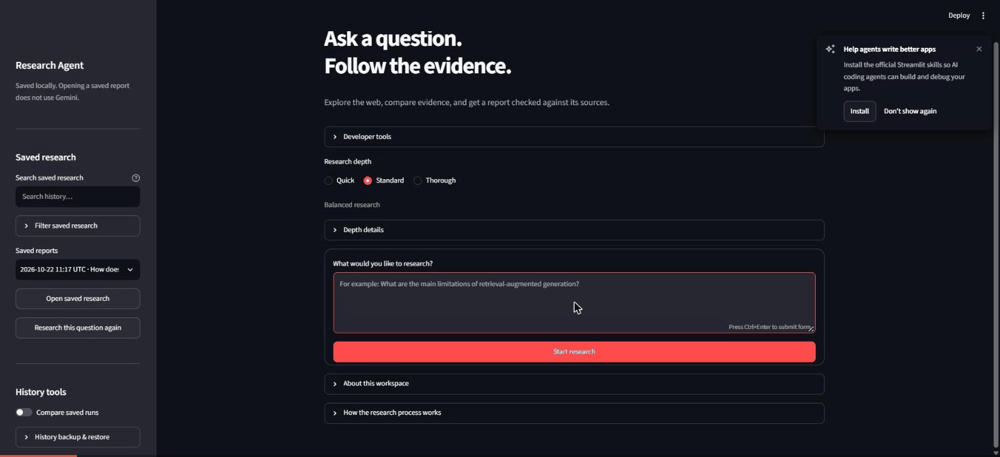

# Research Agent

A research agent that answers questions from the live web **with citations you
can trace and check**, built with Python, LangGraph, Gemini, Tavily and
Streamlit.

It breaks a question into sub-questions, searches the web, reads pages safely,
extracts evidence, decides whether that evidence is enough (researching again
if not), and then writes an answer. Every citation in that answer must pass both
deterministic checks and a separate AI verification pass before it is trusted.

> An LLM should not be trusted merely because it produced a plausible answer.



*A real run on the local app: the question, live progress, a verified answer,
each claim with its source and the exact supporting excerpt, and the run's
budget use (8 of 8 pages read, 12 AI calls).*

## What makes it different

- **Citations are checked, not trusted.**
  - The model can only cite evidence by Python-assigned handles (`E1`, `E2`, …).
  - Every supporting quote must appear word for word in the evidence it cites.
  - Every claim must appear in the answer.
  - A separate verification pass then checks that each quote actually supports
    its claim, and that no factual statement is left uncited.
- **Fail closed.** If any check fails, the whole answer is discarded and the
  report says so, with a fixed reason code such as `quote_mismatch`. A wrong
  answer with confident citations is never released.
- **Bounded by design.** Searches, page reads, AI calls and research rounds are
  limited per run, using a reserve-then-execute pattern. The final two AI calls
  (writing and verifying the answer) are reserved up front, so research can
  never use them up.
- **Web content is untrusted.**
  - Page fetching blocks private and loopback addresses, NAT64 and IPv4-mapped
    tricks, and unsafe redirects, re-checking every redirect.
  - Page text is passed to the model as labeled data, never as instructions.
  - Untrusted text is displayed as plain text only.
- **Measured honestly.** A live-evaluation harness re-scores runs with the same
  code, separates outcome rates from answer quality, and keeps provider outages
  out of the data. Its findings, including what did not work, are below.

## How it works

```text
Question
  → Planner (sub-questions)
  → Search (Tavily)
  → Source admission
  → Safe web fetching
  → Evidence extraction (quotes must exist in the page)
  → Critic ── not enough evidence, budget left ──► follow-up research
  → Synthesis (claims + evidence handles + supporting quotes)
  → Deterministic grounding checks
  → Semantic verification (separate AI pass)
  → Report with trusted citations
```

The workflow is a LangGraph state graph with small, single-purpose nodes,
conditional routing after the Critic, and deterministic reducers. Every external
call goes through a reserve step that decides exactly what is allowed.

**Details:** [docs/ARCHITECTURE.md](docs/ARCHITECTURE.md).

## Evaluation results

Live runs used 8 fixed questions, with expectations written before any run.
Every answer in the pilot was read by hand. Some highlights:

- **The fake question.** "What did the 2031 IEEE standard for quantum TCP
  specify?" was refused in every run, with no invented claims.
- **Run-to-run noise.** Running the same code twice gave the same overall
  averages (verified rate 0.93 and 0.93) but large swings on single questions,
  so a single-question difference proves nothing.
- **A2.** De-duplicating and interleaving evidence before synthesis reduced
  duplicate claims (1.25 → 0.67 per answer) and rejections (4 → 1 of 14, not
  statistically significant). It did not improve source spread.
- **The main remaining weakness.** "Verified" means a quote is real, not that
  its source is right. One blog's error about TCP CUBIC appeared in all 12
  verified CUBIC answers. An AI contradiction check did not catch it (0 of 4
  runs against a target of 3), so it was not shipped.
- **Free-tier reliability.** Gemini's free tier often returned 503 (overloaded).
  The local app now retries temporary errors (408/500/502/503/504) with backoff,
  but never retries quota errors.

**Full method and numbers:** [docs/EVALUATION.md](docs/EVALUATION.md).

## Quick start

Requires Python 3.12+, a Gemini API key and a Tavily API key. The commands are
for Windows PowerShell.

```powershell
python -m venv .venv
.\.venv\Scripts\Activate.ps1
pip install -e ".[dev]"
Copy-Item .env.example .env   # then fill in the values below
```

Minimum `.env` settings:

```text
LLM_PROVIDER=gemini
LLM_MODEL=gemini-3.5-flash-lite
LLM_API_KEY=your-gemini-key
TAVILY_API_KEY=your-tavily-key
```

The research limits in `.env.example` have safe defaults. `.env` is ignored by
Git, so never commit keys.

### Local web app

```powershell
$env:RESEARCH_AGENT_LOCAL = "1"
python -m streamlit run app.py --server.address 127.0.0.1 --server.port 8502 --browser.gatherUsageStats false
```

Then open <http://localhost:8502>.

- **Without `RESEARCH_AGENT_LOCAL=1`,** `app.py` deliberately shows only the
  fictional demo.
- **The app includes** research depth presets, progress, citations with their
  evidence, TXT/JSON downloads, saved history with search, run comparison,
  backup and restore, and an offline demo.

**Guide:** [docs/USER_GUIDE.md](docs/USER_GUIDE.md).

### Command line

```powershell
research-agent "What is retrieval-augmented generation and what problem does it solve?"
```

## Public deployment

The hosted app is at <https://research-agent-frosty.streamlit.app/>. It opens on a
clearly labeled fictional demo (sample report, evidence and run summary), with
no live AI or search calls.

Above the demo, **live research is available with a password** from the author.
It runs on the author's free-tier Gemini and Tavily keys, with Quick-depth limits
per run, 5 runs per hour and 20 per day shared by everyone, one at a time, and a
site-wide lock after repeated wrong passwords. Only a salted scrypt hash of the
password is stored. Details: [docs/PUBLIC_SERVICE.md](docs/PUBLIC_SERVICE.md#password-gated-live-research).

A separate bring-your-own-keys entry point with Google sign-in
(`public_app.py`) is built and tested. Live public research stays
**deliberately disabled** until the launch checklist in
[docs/PUBLIC_SERVICE.md](docs/PUBLIC_SERVICE.md) is done: durable quota
storage, edge rate limits and a reproducible deployment. The hosted app sleeps
when idle, so the first visit can take a minute.

## Testing

```powershell
python -m pytest -q
```

- **2,460 tests** pass on the current `main`. They need no network or API keys:
  every provider is scripted or mocked.
- **Coverage** includes:
  - budgets and reducers
  - URL safety
  - evidence grounding, synthesis and verification
  - the full production graph
  - the Streamlit UI, including hostile page titles rendered as plain text
  - history, backup and restore
  - the public service's isolation and limits
- **Offline scenarios:** `python -m pytest tests/test_offline_evaluation.py -v`.
- **Live evaluation** is separate and uses real quota; see
  [evals/live/README.md](evals/live/README.md).

## Limitations

- **Sources are not fact-checked.** Verification checks that each claim is
  supported by its quote, not that the source itself is correct.
- **All or nothing.** One inexact quote discards the whole answer. This is
  deliberate (fail closed), but it costs some answers.
- **No crash recovery.** There is no persistent checkpointer, so a crashed run
  cannot resume.
- **One provider each.** Gemini is the only LLM provider and Tavily the only
  search provider wired in.
- **Private local app.** The local app has no authentication, and its history
  is shared by sessions on the same instance.
- **Live results vary.** Search results, pages and model output change between
  runs.

## Project layout

```text
app.py                 local app (opt-in) / falls back to the public entry point
public_app.py          public bring-your-own-keys entry point
src/research_agent/
  graph/               LangGraph state, budgets, builder, nodes, rejection codes
  llm/                 provider-neutral client + Gemini adapter
  models/schemas.py    SubQuestion, SearchResult, Source, Evidence, Citation, …
  prompts/             planner, evidence, critic, synthesis, verification prompts
  tools/               URL safety, safe fetching, Tavily search
  live_*.py            live-evaluation runner, metrics, questions, comparison
tests/                 software correctness (offline)
evals/                 offline scenarios and live-evaluation question set
docs/                  architecture, user guide, evaluation, public service
```

## License

[MIT](LICENSE) © 2026 Sayantan Chaklader.
